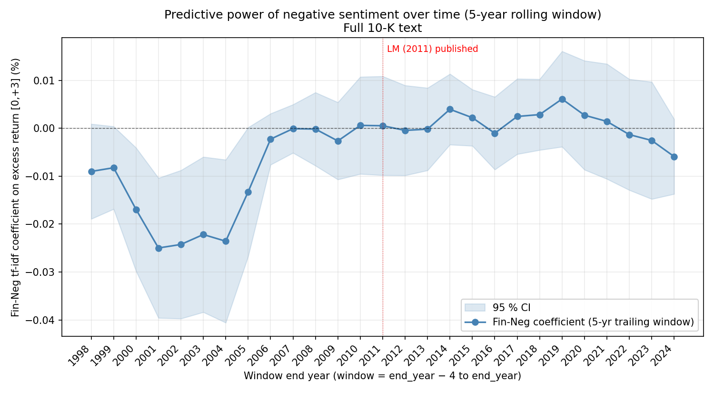
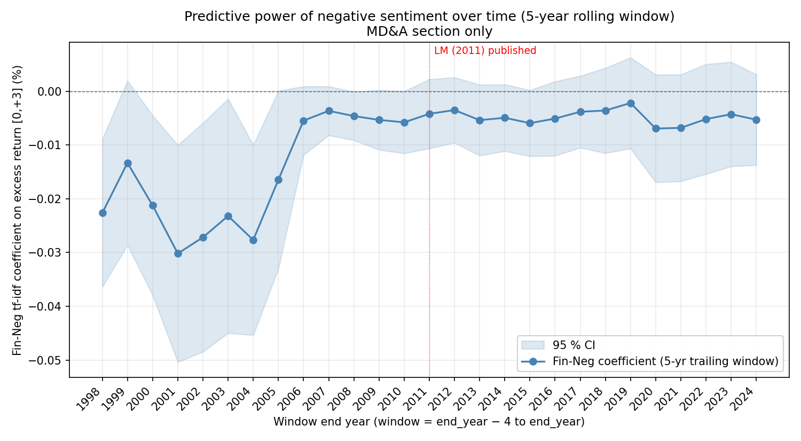

# Out-of-sample extension of LM (2011) — 1994–2024

This document extends the Loughran and McDonald (2011) Fama-MacBeth filing-period excess-return regressions from the LM in-sample window (1994–2008) through end of 2024 (~17 additional years of 10-K filings), using the identical methodology (same dictionary, same controls, same FM weighting, same Newey-West HAC SE, same FF48 industry fixed effects).

The exposition below focuses on the per-filing negative sentiment score based on the LM (2011) financial sentiment dictionary (hereinafter referred to as **Fin-Neg**). The headline specification is the tf-idf-weighted version of Fin-Neg, which weights each negative-tone word by its inverse document frequency across the corpus — the richer of the two LM specifications; the alternative is an unweighted proportional version (negative-word count divided by total words). Each analysis is reported in two parallel versions: one on the full 10-K text and one restricted to the MD&A section only. Results for the unweighted proportional Fin-Neg are reported alongside in the companion tables without separate discussion.

Three questions:

1. **Out-of-sample**: does the tf-idf negative-tone signal still predict four-day excess returns in 2009–2024?
2. **Decay**: how does the coefficient evolve year by year across the full sample?
3. **Regime conditioning**: how does it look in the GFC, the algo-trading era, and COVID-recent windows?

---

## Sample

| Window | Firm-years | Unique permnos | Quarters |
|---|---:|---:|---:|
| LM in-sample (1994–2008) | 50,902 | 8,937 | 60 |
| Extension (2009–2024) | 45,429 | 6,332 | 63 |
| Full extended (1994–2024) | 96,331 | 11,968 | 123 |

CRSP daily ends 2024-12-31 (typical WRDS lag), so the post-filing window required for the sample funnel drops filings from the final weeks of 2024.

Inputs were rebuilt end-to-end via `code/preclean.py` (`END_YR = 2026`), `code/step1c_manifest_10k_extended.py`, then the standard `step4 → step5 → step6 → step7` pipeline.

One small methodology refinement was added for the post-2009 portion of the sample: inline-XBRL `<ix:hidden>` blocks are stripped from the raw text before tokenization. These blocks wrap content tagged for machine readers but not visible to humans in the rendered document; in early-adopter filings (2019–2022) some filers tagged narrative prose this way, which could double-count LM-dictionary tokens against text the visible reader saw once. Pre-2009 filings have no inline XBRL so this is a no-op on the LM in-sample window. Empirically the change shifts every coefficient by less than 0.5%.

---

## Headline results

### Full 10-K text

| Specification | n | n_qtrs | Coef | t-stat | adj R² |
|---|---:|---:|---:|---:|---:|
| LM (2011) original result | 50,115 | 60 | −0.0030 | −3.11 | 2.63 % |
| My replication (sample period: 1994–2008) | 50,681 | 60 | −0.0105 | −2.74 | 2.52 % |
| Extended sample (1994–2024) | 95,210 | 123 | −0.0046 | −1.83 | 3.91 % |

Each row is a Fama-MacBeth regression of the four-day filing-period excess return on Fin-Neg (tf-idf) with the LM control set and FF48 industry fixed effects: per quarter we run a single cross-sectional regression and save its Fin-Neg coefficient, then average those per-quarter coefficients across the `n_qtrs` quarters in the row. The reported t-stat is that pooled average divided by a Newey-West HAC (1 lag) standard error on the per-quarter coefficient series.

In the full extended sample the headline tf-idf coefficient remains negative (p ≈ 0.068), but less significant than in the LM in-sample reproduction. The pooled result is dominated by the LM in-sample sub-period; the sub-period and rolling-window decompositions below show where the signal lives.

### MD&A section only

| Specification | n | n_qtrs | Coef | t-stat | adj R² |
|---|---:|---:|---:|---:|---:|
| LM (2011) original result | 37,287 | 60 | −0.0060 | −1.96 | 2.76 % |
| My replication (sample period: 1994–2008) | 48,134 | 60 | −0.0161 | −3.56 | 2.46 % |
| Extended sample (1994–2024) | 92,369 | 123 | −0.0108 | −3.97 | 3.76 % |

The MD&A-restricted specification is more robust than the full-text version: the t-stat is actually larger in absolute value in the extended sample than in the LM in-sample sub-period. This is the cleanest evidence that managerial-discretion tone — the MD&A section is where Reg S-K Item 303 directs management to discuss known trends and uncertainties — continues to carry priceable information through 2024.

---

## Sub-period replication

Each subperiod is re-fit with the same Fama-MacBeth regression on its own quarterly cross-sections.

### Full 10-K text

| Subperiod | Years | n | n_qtrs | Coef | t-stat | adj R² |
|---|---|---:|---:|---:|---:|---:|
| LM_in_sample | 1994–2008 | 50,681 | 60 | −0.0105 | −2.74 | 2.52 % |
| GFC | 2008–2009 | 6,077 | 8 | −0.0082 | −1.49 | 3.48 % |
| post_LM | 2009–2014 | 17,363 | 24 | +0.0015 | +0.41 | 4.53 % |
| algo_era | 2015–2019 | 13,525 | 20 | +0.0061 | +1.20 | 7.78 % |
| covid_recent | 2020–2024 | 13,641 | 19 | −0.0059 | −1.48 | 3.51 % |
| full | 1994–2024 | 95,210 | 123 | −0.0046 | −1.83 | 3.91 % |

The full-text signal is concentrated in the LM_in_sample row. It flips to positive (insignificant) in `post_LM` and `algo_era` — the early post-publication period and the algo-trading era — then turns negative again, without significance, in `covid_recent`.

### MD&A section only

| Subperiod | Years | n | n_qtrs | Coef | t-stat | adj R² |
|---|---|---:|---:|---:|---:|---:|
| LM_in_sample | 1994–2008 | 48,134 | 60 | −0.0161 | −3.56 | 2.46 % |
| GFC | 2008–2009 | 6,027 | 8 | −0.0069 | −1.20 | 3.38 % |
| post_LM | 2009–2014 | 17,241 | 24 | −0.0053 | −1.73 | 4.36 % |
| algo_era | 2015–2019 | 13,441 | 20 | −0.0022 | −0.51 | 7.55 % |
| covid_recent | 2020–2024 | 13,553 | 19 | −0.0053 | −1.23 | 3.19 % |
| full | 1994–2024 | 92,369 | 123 | −0.0108 | −3.97 | 3.76 % |

The MD&A specification carries a negative coefficient in every single sub-period. Statistical significance is concentrated in the LM in-sample row and the full pooled fit (t = −3.97), with `post_LM` borderline at t = −1.73. The contrast with the full-text panel is the key empirical claim of the extension: the discretionary MD&A region preserves a directionally consistent signal even where the broader full-text version has decayed.

### Companion: Fin-Neg proportional (un-weighted)

For completeness, the proportional (unweighted) results across the same subperiods:

| Subperiod | Years | Full-text t-stat | Full-text R² | MD&A t-stat | MD&A R² |
|---|---|---:|---:|---:|---:|
| LM_in_sample | 1994–2008 | −3.04 | 2.29 % | −3.54 | 2.37 % |
| GFC | 2008–2009 | −0.18 | 3.44 % | −2.79 | 3.24 % |
| post_LM | 2009–2014 | +1.16 | 4.58 % | −0.63 | 4.40 % |
| algo_era | 2015–2019 | +0.78 | 7.55 % | −1.70 | 7.42 % |
| covid_recent | 2020–2024 | −0.41 | 3.06 % | +1.94 | 3.46 % |
| full | 1994–2024 | −1.86 | 3.71 % | −2.46 | 3.74 % |

The proportional-weighted result tells the same story qualitatively: full-text loses significance and even flips sign in post-LM / algo-era; MD&A stays negative pooled (t = −2.46) and significant in two of five sub-periods.

---

## Rolling-window decay

### Design

The sub-period analysis above partitions the sample into a handful of disjoint regimes (LM_in_sample, GFC, post_LM, …). That collapses what is plausibly a gradual evolution of the negative-tone signal into discrete buckets and depends on where we drew the boundaries. The rolling-window analysis below avoids both issues — it asks, year by year, *what does the tf-idf Fin-Neg coefficient look like if we re-fit it only on the trailing 5 years of filings?*

The procedure indexes windows by their end year *y*. For each end year:

1. Take the subset of the extended panel with `date_filed` in calendar years `[y − 4, y]` — a 5-year backward-looking window of filings, giving 5 × 4 = 20 quarterly cross-sections.
2. Standardize Fin-Neg tf-idf over the window's regression sample (after 1/99 % winsorizing), so the coefficient is in pp of excess return per one SD of Fin-Neg in that window. The tf-idf scale drifts over time, and this keeps windows comparable; as a constant rescaling within each window it leaves the t-statistics unchanged.
3. Run the same Fama-MacBeth quarterly cross-sectional regression on the standardized Fin-Neg tf-idf with the standard control set (log size + log BM + log turnover + pre-event FF-α + IO + NASDAQ + FF48 industry FEs). Save the per-quarter Fin-Neg coefficient β_q.
4. The window's reported coefficient is the time-series average β̄ across those ~20 quarterly βs, weighted by *n_obs/q*. The standard error is a Newey-West HAC (1 lag) on the β_q series. R² is the simple time-series average of per-quarter adjusted R².
5. Increment the end year by one and repeat.

Pre-1994 filings are excluded entirely. EDGAR was launched in May 1993 and mandatory electronic filing only phased in by May 1996; the manifest contains just 6 raw 10-K filings for calendar-year 1993, of which 2 survive the sample funnel. Aligning the window's earliest year with LM (2011)'s own sample-start convention means the first window has end year `1998` (covering filings 1994–1998); the last window has end year `2024` (covering 2020–2024). That gives 27 windows in total.

Compared to the discrete sub-period table, the rolling design (i) smooths through quarter-to-quarter noise via the four-year overlap, (ii) makes "decay or stable?" a continuous-time question rather than a comparison of bucketed snapshots, (iii) lets us draw a single chart with a 95 % confidence band that a recruiter can read without parsing six rows of t-statistics, and (iv) uses only backward-looking information at each year *y* — the chart at point *y* never knows about post-*y* data.

A caveat for the late windows: the end year *y* requires CRSP daily coverage after the filings in year *y* (for the post-filing window). At the current WRDS CRSP daily end of 2024-12-31, the `y = 2024` window loses filings from the final weeks of 2024.

### Full 10-K text

(*plot file*: `output/data_tables_figures/fig_sentiment_decay.png`; underlying CSV: `output/data_tables_figures/sentiment_decay.csv`)

| End year | Window | n | Coef (pp per SD) | t-stat | adj R² |
|---:|---|---:|---:|---:|---:|
| 1998 | 1994–1998 | 14,849 | −0.085 | −1.78 | 1.46 % |
| 1999 | 1995–1999 | 17,915 | −0.079 | −1.87 | 0.75 % |
| 2000 | 1996–2000 | 20,258 | −0.167 | −2.58 | 1.70 % |
| 2001 | 1997–2001 | 20,966 | −0.252 | −3.35 | 2.84 % |
| 2002 | 1998–2002 | 19,862 | −0.261 | −3.07 | 2.67 % |
| 2003 | 1999–2003 | 18,662 | −0.260 | −2.68 | 3.24 % |
| 2004 | 2000–2004 | 17,990 | −0.297 | −2.72 | 4.09 % |
| 2005 | 2001–2005 | 17,226 | −0.178 | −1.93 | 3.43 % |
| 2006 | 2002–2006 | 17,043 | −0.032 | −0.84 | 1.82 % |
| 2007 | 2003–2007 | 17,063 | −0.001 | −0.03 | 2.42 % |
| 2008 | 2004–2008 | 17,170 | −0.002 | −0.04 | 2.68 % |
| 2009 | 2005–2009 | 16,387 | −0.039 | −0.64 | 2.87 % |
| 2010 | 2006–2010 | 16,009 | +0.009 | +0.11 | 3.66 % |
| 2011 | 2007–2011 | 15,594 | +0.008 | +0.10 | 4.40 % |
| 2012 | 2008–2012 | 15,011 | −0.007 | −0.09 | 4.36 % |
| 2013 | 2009–2013 | 14,450 | −0.003 | −0.04 | 4.38 % |
| 2014 | 2010–2014 | 14,639 | +0.065 | +1.05 | 4.42 % |
| 2015 | 2011–2015 | 14,526 | +0.037 | +0.73 | 4.84 % |
| 2016 | 2012–2016 | 14,314 | −0.018 | −0.27 | 5.49 % |
| 2017 | 2013–2017 | 14,172 | +0.044 | +0.61 | 6.32 % |
| 2018 | 2014–2018 | 13,897 | +0.053 | +0.76 | 8.19 % |
| 2019 | 2015–2019 | 13,525 | +0.117 | +1.20 | 7.78 % |
| 2020 | 2016–2020 | 13,062 | +0.055 | +0.47 | 5.96 % |
| 2021 | 2017–2021 | 13,176 | +0.031 | +0.23 | 5.45 % |
| 2022 | 2018–2022 | 13,489 | −0.031 | −0.22 | 4.88 % |
| 2023 | 2019–2023 | 13,676 | −0.062 | −0.41 | 3.46 % |
| 2024 | 2020–2024 | 13,641 | −0.149 | −1.48 | 3.51 % |

The full-text coefficient is negative and significant (t below −2) only for end years 2000–2004. The 1998–1999 windows are borderline, and the long stretch from end year 2006 through 2024 oscillates sign with t-stats between −1.5 and +1.2 — economically indistinguishable from zero.

### MD&A section only

(*plot file*: `output/data_tables_figures/fig_sentiment_decay_mda.png`; underlying CSV: `output/data_tables_figures/sentiment_decay_mda.csv`)

| End year | Window | n | Coef (pp per SD) | t-stat | adj R² |
|---:|---|---:|---:|---:|---:|
| 1998 | 1994–1998 | 13,452 | −0.153 | −3.22 | 1.81 % |
| 1999 | 1995–1999 | 16,391 | −0.099 | −1.71 | 0.91 % |
| 2000 | 1996–2000 | 18,724 | −0.175 | −2.49 | 1.85 % |
| 2001 | 1997–2001 | 19,545 | −0.270 | −2.93 | 3.00 % |
| 2002 | 1998–2002 | 18,693 | −0.278 | −2.50 | 2.75 % |
| 2003 | 1999–2003 | 17,734 | −0.273 | −2.09 | 3.06 % |
| 2004 | 2000–2004 | 17,252 | −0.370 | −3.07 | 3.96 % |
| 2005 | 2001–2005 | 16,665 | −0.244 | −1.95 | 3.24 % |
| 2006 | 2002–2006 | 16,633 | −0.080 | −1.68 | 1.56 % |
| 2007 | 2003–2007 | 16,759 | −0.052 | −1.57 | 2.04 % |
| 2008 | 2004–2008 | 16,948 | −0.062 | −2.01 | 2.38 % |
| 2009 | 2005–2009 | 16,220 | −0.068 | −1.88 | 2.63 % |
| 2010 | 2006–2010 | 15,866 | −0.066 | −1.96 | 3.47 % |
| 2011 | 2007–2011 | 15,464 | −0.050 | −1.28 | 4.08 % |
| 2012 | 2008–2012 | 14,893 | −0.043 | −1.13 | 4.12 % |
| 2013 | 2009–2013 | 14,345 | −0.068 | −1.60 | 4.15 % |
| 2014 | 2010–2014 | 14,541 | −0.061 | −1.56 | 4.19 % |
| 2015 | 2011–2015 | 14,442 | −0.073 | −1.89 | 4.62 % |
| 2016 | 2012–2016 | 14,234 | −0.066 | −1.44 | 5.42 % |
| 2017 | 2013–2017 | 14,094 | −0.051 | −1.12 | 6.36 % |
| 2018 | 2014–2018 | 13,813 | −0.051 | −0.89 | 8.05 % |
| 2019 | 2015–2019 | 13,441 | −0.033 | −0.51 | 7.55 % |
| 2020 | 2016–2020 | 12,977 | −0.105 | −1.36 | 5.90 % |
| 2021 | 2017–2021 | 13,092 | −0.098 | −1.34 | 5.54 % |
| 2022 | 2018–2022 | 13,403 | −0.081 | −0.99 | 4.80 % |
| 2023 | 2019–2023 | 13,588 | −0.071 | −0.86 | 3.58 % |
| 2024 | 2020–2024 | 13,553 | −0.095 | −1.23 | 3.19 % |

The MD&A coefficient is negative in every one of the 27 windows. Statistical significance (|t| ≥ 1.96) is concentrated in 1998, 2000–2004, 2008 and 2010, with many post-2005 estimates falling short of conventional significance thresholds. The qualitative contrast with the full-text panel above is the headline finding: where the full-text signal decays and oscillates sign post-2005, the MD&A signal weakens in magnitude but stays directionally consistent throughout.

---

## Event-window robustness

LM (2011) defines its CAR over a four-day window `[0, +3]` covering the filing day plus three subsequent trading days. To check whether the result is special to that window, each subperiod regression is re-fit with three LHS event windows: `[0,+1]`, `[0,+3]` (LM canonical), `[0,+5]`. Longer horizons, `[0,+10]` and `[0,+20]`, are reported separately below because they also capture returns driven by events after the filing. Each cell below shows `t (adj R²)`.

### Full 10-K text

| Subperiod (n_qtrs) | n (canonical) | [0,+1] | [0,+3] | [0,+5] |
|---|---:|---:|---:|---:|
| LM_in_sample (60q) | 50,681 | −1.61 (1.99 %) | −2.74 (2.52 %) | −2.23 (2.68 %) |
| post_LM (24q) | 17,363 | +0.17 (3.36 %) | +0.41 (4.53 %) | +0.53 (5.04 %) |
| algo_era (20q) | 13,525 | +0.86 (6.60 %) | +1.20 (7.78 %) | +2.01 (7.90 %) |
| covid_recent (19q) | 13,641 | −0.11 (2.69 %) | −1.48 (3.51 %) | −2.84 (3.73 %) |
| full (123q) | 95,210 | −0.95 (3.17 %) | −1.83 (3.91 %) | −1.71 (4.19 %) |

The LM in-sample t-stats are stable across the three event windows, peaking at the canonical `[0,+3]`. Post-LM and algo-era are flat to slightly positive at every window, indicating the full-text signal does not survive at any reasonable post-filing horizon after 2008.

### MD&A section only

| Subperiod (n_qtrs) | n (canonical) | [0,+1] | [0,+3] | [0,+5] |
|---|---:|---:|---:|---:|
| LM_in_sample (60q) | 48,134 | −2.23 (1.73 %) | −3.56 (2.46 %) | −3.02 (2.52 %) |
| post_LM (24q) | 17,241 | −1.50 (3.17 %) | −1.73 (4.36 %) | +0.18 (4.74 %) |
| algo_era (20q) | 13,441 | −1.02 (6.57 %) | −0.51 (7.55 %) | −0.30 (7.40 %) |
| covid_recent (19q) | 13,553 | −0.84 (2.50 %) | −1.23 (3.19 %) | −0.17 (3.59 %) |
| full (123q) | 92,369 | −3.09 (2.95 %) | −3.97 (3.76 %) | −2.74 (3.94 %) |

The MD&A coefficient is negative at the `[0,+1]` and `[0,+3]` windows in every sub-period. The full-pooled t-stats are `−3.09 / −3.97 / −2.74` across the three event windows — the MD&A spec is significantly negative at every horizon, with `[0,+3]` again the local maximum.

### Companion: Fin-Neg proportional across the same windows

| Subperiod | n | Full-text [0,+1] | Full-text [0,+3] | Full-text [0,+5] | MD&A [0,+1] | MD&A [0,+3] | MD&A [0,+5] |
|---|---:|---:|---:|---:|---:|---:|---:|
| LM_in_sample | 50,681 | −1.47 | −3.04 | −2.45 | −2.11 | −3.54 | −3.07 |
| post_LM | 17,363 | +1.31 | +1.16 | +1.35 | −0.70 | −0.63 | +0.36 |
| algo_era | 13,525 | +0.60 | +0.78 | +1.80 | −2.37 | −1.70 | −1.49 |
| covid_recent | 13,641 | +0.15 | −0.41 | −2.20 | +1.37 | +1.94 | +2.09 |
| full | 95,210 | −0.38 | −1.86 | −1.65 | −1.80 | −2.46 | −1.50 |

Three patterns emerge:

1. **LM in-sample is window-robust.** Across both the full-text and MD&A specs, the canonical `[0,+3]` t-statistic is the local maximum (in absolute value) of a hump that includes `[0,+1]` and `[0,+5]`. The signal is real on the 1994–2008 sub-window and is not an artifact of choosing exactly four days.

2. **The decay is most visible in the very-short windows.** For the `post_LM` and `algo_era` sub-periods, the `[0,+1]` and `[0,+3]` t-statistics on full-text tf-idf cluster near zero or flip sign. If markets price negative tone faster post-2010 than they did in the 1990s, the short-window absence of signal is consistent with that.

3. **MD&A tf-idf is the most window-stable.** For the MD&A-only spec, the full extended sample shows `t = −3.09 / −3.97 / −2.74` across `[0,+1] / [0,+3] / [0,+5]`. The negative sign also persists in MD&A across most sub-periods at the canonical `[0,+3]` window. The robustness reflects that MD&A text — forward-looking commentary by management — carries information that is priced over a longer post-filing horizon than mechanical text features in the rest of the 10-K.

### Robustness check: longer windows `[0,+10]` and `[0,+20]`

These horizons are reported only as a robustness check: over two to four weeks the excess return also absorbs post-filing drift, other firms' news and macroeconomic news unrelated to the 10-K. The regression is otherwise identical. Each cell shows `t (adj R²)`; the `[0,+3]` and `[0,+5]` columns repeat the t-stats from the main event-window table for comparison. Sub-period results are in `output/table_event_windows_long.md`.

| Specification | Subperiod | [0,+3] | [0,+5] | [0,+10] | [0,+20] |
|---|---|---:|---:|---:|---:|
| Proportional, full text | LM_in_sample | −3.04 | −2.45 | −1.24 (3.82 %) | +0.13 (5.77 %) |
| Proportional, full text | full | −1.86 | −1.65 | −0.42 (5.20 %) | +0.11 (6.93 %) |
| tf-idf, full text | LM_in_sample | −2.74 | −2.23 | −1.37 (3.96 %) | −0.45 (5.99 %) |
| tf-idf, full text | full | −1.83 | −1.71 | −0.84 (5.36 %) | −0.85 (7.07 %) |
| Proportional, MD&A | LM_in_sample | −3.54 | −3.07 | −2.37 (3.79 %) | −1.59 (5.57 %) |
| Proportional, MD&A | full | −2.46 | −1.50 | −1.11 (5.07 %) | −0.41 (6.70 %) |
| tf-idf, MD&A | LM_in_sample | −3.56 | −3.02 | −2.17 (3.86 %) | −1.22 (5.60 %) |
| tf-idf, MD&A | full | −3.97 | −2.74 | −1.73 (5.12 %) | −1.08 (6.65 %) |

Significance fades as the window lengthens: in the LM in-sample period only the MD&A specifications remain significant at the 5 % level at `[0,+10]`, and none is at `[0,+20]`; in the full extended sample none is significant at the 5 % level at either horizon (MD&A tf-idf is significant at 10 % at `[0,+10]`). The point estimates mostly do not shrink: for the MD&A specifications and full-text tf-idf at `[0,+10]` they stay close to their `[0,+3]` values, while standard errors rise two- to threefold as the longer windows add return variation unrelated to the filing. These cumulative-return regressions do not separately test drift or reversal after the initial filing response. That would require regressions on returns after day +3 or a joint test of the differences between horizons.

---

## Interpretation

Two qualitatively different stories emerge from the rolling-window decompositions:

**Full 10-K text.** The tf-idf negative-tone signal is statistically significant and negatively-signed only in one stretch of the rolling decomposition:

- end years 2000–2004 (windows covering filings 1996–2000 through 2000–2004), with t between −2.58 and −3.35 and R² between 1.70 % and 4.09 %.

In all other rolling windows the coefficient is near zero with t between −1.93 and +1.20. The classical post-publication-arbitrage explanation (McLean and Pontiff 2016) cannot account for this pattern alone: the rolling-window coefficient drifts to zero by end year 2006 (window 2002–2006), which corresponds to filings made well before Loughran and McDonald (2011) was published in early 2011. Three non-exclusive candidate mechanisms are worth flagging without a clean test of any of them:

1. **Pre-publication discovery.** Tetlock (2007) used the Harvard IV-4 dictionary on Wall Street Journal media content. Practitioner sentiment scoring of news + filings (Reuters, Bloomberg, RavenPack) was deployed in the same window. Filing-period negative-tone may have been priced by sentiment-active quants before LM curated their finance-specific dictionary.

2. **Disclosure-norm shift after Sarbanes-Oxley (2002).** Post-SOX 10-Ks contain richer cautionary boilerplate and lengthy risk factors, and from 2009 inline XBRL tags. The Table II mean of Fin-Neg in the full extended sample is 1.64 % vs the LM in-sample mean of 1.37 %, consistent with rising boilerplate that dilutes idiosyncratic tone variation.

3. **Algorithmic pricing of public text.** From 2010 onward, the LM Master Dictionary is embedded in many quant pipelines. Negative tone may now be priced within minutes of filing release, leaving no four-day excess-return predictability available to academic researchers using daily CRSP returns.

**MD&A section only.** The MD&A-restricted coefficient is negative in every single rolling window across 1998–2024 and significant pooled (t = −3.97) on the full extended sample. The signal weakens in magnitude after about 2006 — broadly the same inflection point as full-text — but never crosses zero. This pattern is consistent with the regulatory framing of MD&A under Reg S-K Item 303: management is required to discuss known trends, demands, and uncertainties, so the MD&A region carries discretionary forward-looking content that is harder to mechanically arbitrage than risk-factor and footnote boilerplate. The MD&A-only specification is the single specification that remains significant pooled across 1994–2024.

---

## Files

| File | Source script |
|---|---|
| `output/data_tables_figures/table1_sample_funnel.csv` | `step5_build_sample.py` (extended) |
| `output/data_tables_figures/table2.csv` | `step7_tables.py` |
| `output/data_tables_figures/table4_cols2_4.csv` | `step7_tables.py` |
| `output/data_tables_figures/table5_cols2_4.csv` | `step7_tables.py` |
| `output/data_tables_figures/table_subperiods.csv`, `output/table_subperiods.md` | `step9_subperiods.py` |
| `output/data_tables_figures/sentiment_decay.csv`, `output/data_tables_figures/sentiment_decay_mda.csv` | `step10_decay.py` |
| `output/data_tables_figures/fig_sentiment_decay.png`, `output/data_tables_figures/fig_sentiment_decay_mda.png` | `step10_decay.py` |
| `output/data_tables_figures/table_event_windows.csv`, `output/table_event_windows.md` | `step11_event_windows.py` |

---

## References

- Loughran, Tim, and Bill McDonald, 2011. “When Is a Liability Not a Liability? Textual Analysis, Dictionaries, and 10-Ks”, *Journal of Finance* 66(1): 35–65.
- McLean, R. D., and Jeffrey Pontiff, 2016. “Does Academic Research Destroy Stock Return Predictability?”, *Journal of Finance* 71(1): 5–32.
- Tetlock, Paul C., 2007. “Giving Content to Investor Sentiment: The Role of Media in the Stock Market”, *Journal of Finance* 62(3): 1139–1168.
